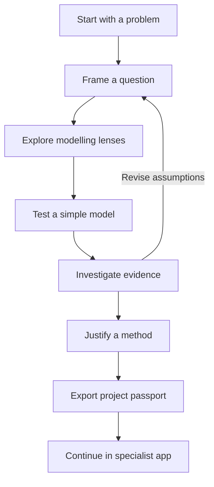

# ModSimCompass Implementation Plan

> **Superseded (21 Nov 2026).** The product is now a project compass. The governing specification is [docs/COMPASS-SPEC.md](./docs/COMPASS-SPEC.md); see [ADR 0003](./docs/adr/0003-project-compass.md). This document is kept for history.

> Product name: **ModSimCompass** (earlier names: ModSim101, ModSim Essentials). Storage identifiers keep the `modsim101` prefix; see docs/current-state-audit.md. Implementation evidence: [docs/release-evidence.md](./docs/release-evidence.md).

> Agent-ready product specification · Version 1.0 · 20 November 2026  
> Companion: [STYLE.md](./STYLE.md). PLAN owns educational behaviour, scientific semantics, data, architecture, migration and delivery. STYLE owns appearance, interaction, visualisation and accessibility. This is a target specification; the ModSimCompass repository has not been inspected or modified.

## 1 Mission and source authority

**ModSimCompass teaches students to think like modellers before selecting a specialist technique.** It is the introductory application for a master’s course in Modelling and Simulation at FIPU, Juraj Dobrila University of Pula. Students already have separate specialist apps. Keep those apps separate. ModSimCompass supplies the shared intellectual workflow and launches the semester project.

The central learner journey is **problem → question → representation → evidence → decision**. Students must leave with a defensible question, justified method choice, explicit assumptions and a plan for checking the model. The app should remain useful at later project checkpoints.

| Source | Authority | Does not establish |
| --- | --- | --- |
| Supplied `PLAN(20261120-203307).md` | Audit-first implementation, preservation, pure domain core, local-first persistence, scientific contracts, staged delivery, 12/12/12 content structure, Netlify/Railway requirements | ModSimCompass’s current code, seven existing Monte Carlo simulations, need for a stochastic DAG builder or mandatory Python/R exports |
| Supplied `STYLE(10).md` | Exact base theme tokens, typography, shell dimensions, component language, chart grammar, accessibility discipline | Current ModSimCompass implementation or need for Monte Carlo-specific nodes |
| Course framework and agreed ModSimCompass concept | Shared lifecycle, separate specialist apps, model passport, master’s project, six core experiences | An approved institutional grading policy or actual specialist app URLs |

MUST denotes a requirement within its assigned phase. SHOULD permits a documented alternative. LATER is outside the initial release. All implementation checkboxes start unchecked; record evidence before marking complete.

### 1.1 Outcomes

Students can frame a decision question; define scope, boundary and horizon; distinguish variables, states, stocks, flows, events, entities and agents; explain deterministic/stochastic and static/dynamic distinctions; select and critique methods; distinguish verification, validation and calibration; interpret simulation uncertainty; design a fair comparison; communicate a conditional recommendation; and export a project passport.

### 1.2 Boundaries

- Local-first browser application. No account, backend, AI provider or paid service required.
- Six core destinations: Start Here, Modelling Lenses, Sandbox, Model Detective, Choose a Method, My Project.
- Learn, Examples, Challenges, Glossary, Projects and Settings are secondary destinations.
- No universal simulation builder, full SEM estimation, complete DES editor, Petri-net analysis engine, ABM authoring engine or automatic translation between methods.
- No leaderboard, mandatory streaks or speed-based scoring. Academic judgement matters more than clicks.
- No automatic grading of unrestricted written reasoning by keyword matching or undisclosed AI.
- Preserve existing useful ModSimCompass functionality after an audit; do not assume it is an empty repository.
- English interface initially; content keys must permit later Croatian localisation. Do not publish machine-translated scientific terminology without review.

## 2 Audit and preservation before implementation

1. Read repository instructions, README, package manifest, lockfile, source, routes, persistence and hosting configuration.
2. Run the existing build and relevant checks; record baseline failures without attributing them to this work.
3. Inventory current pages, examples, calculations, exports, lesson progress, themes and stored projects in `docs/current-state-audit.md`.
4. Classify each capability as verified, documented-only, broken, missing or superseded with rationale.
5. Capture current representative screens and input/output fixtures. Map old routes to retained routes or redirects.
6. Document what must migrate, including saved project and learning-progress schemas. Preserve unknown old fields in a backup rather than discarding them silently.
7. Confirm library choices from actual dependencies; record significant changes in an ADR.

| Audit area | Required record | Preservation rule |
| --- | --- | --- |
| Navigation | Existing routes and bookmarks | Old links redirect where a meaningful equivalent exists |
| Learning | Existing lessons, quizzes and progress | Archive or map legacy content; do not count archived entries in new 12/12/12 catalog |
| Simulations | Current formulas, defaults and traces | Preserve correct capabilities; fix defects with reference fixtures |
| Projects | Data schema, storage keys and recovery | Backup before migration; reject unsupported future schema safely |
| Exports | Existing formats and semantics | Preserve working exports unless explicit replacement is justified |
| Themes and accessibility | Screenshots and known deficiencies | Improve using STYLE without removing useful keyboard paths |
| Hosting | Existing deployment and routing | Both Netlify and Railway remain supported |

## 3 Information architecture

| Destination | Route proposal | Primary action | Persistent output |
| --- | --- | --- | --- |
| Start Here | `/start` | Investigate your first problem | Guided first-session progress and brief draft |
| Modelling Lenses | `/lenses` | Compare two representations | Notes linked to the passport |
| Sandbox | `/sandbox` | Run model | Model revision, scenario snapshots and runs |
| Model Detective | `/detective` | Investigate the evidence | Case attempts, checks and revised claims |
| Choose a Method | `/methods` | Compare candidates | Shortlist, reasons and learner justification |
| My Project | `/project/:id` | Continue model passport | Versioned passport and review checkpoints |
| Learn / Examples / Challenges | `/learn`, `/examples`, `/challenges` | Continue selected activity | Versioned progress |
| Glossary / Projects / Settings | `/glossary`, `/projects`, `/settings` | Context-dependent | Local preferences and project inventory |

Route names are proposals; reconcile with existing URLs during audit. Keep one active project across views. Opening an example must offer a separate draft or explicit replacement; never overwrite an active project silently.



## 4 Start Here and first-session experience

The first screen presents one short scenario and **Investigate your first problem** as its primary action. Continue work and Explore the course are secondary. Do not begin with an extensive technique catalogue or an empty dashboard.

Default scenario: “Students complain that university support is too slow. Management wants to hire another employee.” The learner first distinguishes the observed concern, proposed intervention and answerable question.

A six-step brief editor asks for stakeholder, decision, outcome, boundary, horizon and constraints. Every step includes an example, a short explanation and an editable field. Permit skipping and returning; a draft is valid work, not a failed answer. A live preview combines the fields into a brief, but generated prose remains editable and must not invent facts.

Suggested first session, approximately 25–40 minutes at the learner’s pace:

1. Identify why hiring is a proposal rather than a problem definition.
2. Create a question about backlog and capacity within a fixed budget.
3. Inspect two lenses of the same service.
4. Predict the effect of changing capacity in a five-day sandbox.
5. Run, compare with the prediction and inspect the arithmetic.
6. Identify one assumption and one limitation.
7. Save a passport draft and choose a next lesson.

The first slice uses backlog, not waiting time: the initial aggregate engine cannot compute individual waiting-time distributions. The app must explain this limitation when a learner selects waiting time as an outcome.

## 5 Modelling Lenses

### 5.1 Signature experience

Use one university support service as a shared setting. Switching lenses changes the representation and the question, not merely the diagram styling. Keep a visible question, model boundary, “reveals” and “omits” panel. Support side-by-side comparison of two lenses on desktop and stacked comparison on mobile.

| Lens | Visual | Small interaction | Leads towards | Limitation |
| --- | --- | --- | --- | --- |
| Relationships and measurement | Observed variables and latent constructs with distinct notation | Toggle indicators or a proposed relationship; view authored explanation | Path analysis, CB-SEM, PLS-SEM | Arrows are hypotheses; no causal proof or estimation occurs here |
| Process and concurrency | Small activity/process view plus a labelled Petri-net teaching view | Step through a supplied trace and inspect a blocked state | Petri nets | A generic process diagram is not automatically a Petri net |
| States and transitions | State graph plus supplied transition matrix | Advance a probability vector one step | Markov chains | State definitions must justify the Markov assumption |
| Uncertain inputs | Bounded discrete demand probabilities and outcome samples | Change variability while keeping the mean fixed | Monte Carlo | Outcome variability differs from uncertainty in an estimated mean |
| Accumulation and feedback | Stock-flow diagram with a separately labelled feedback view | Step backlog; enable a documented feedback rule | System dynamics | Daily aggregate approximation, not a general continuous-time solver |
| Events and resources | Authored arrival/service event timeline | Step a small deterministic event fixture | Queueing theory and DES | General queues and waiting-time experiments belong in specialist apps |
| Spatial interaction | Grid with a fixed local rule and boundary legend | Compare a small supplied grid under two boundary settings | Cellular automata | A spatial question must be introduced explicitly |
| Individual interaction | Small heterogeneous-agent scenario with rule cards | Inspect fixed action traces under alternative rules | ABM | Behaviour is hypothetical unless supported by evidence |

Except for the specified backlog and Markov micro-calculation, initial lens interactions may be finite authored fixtures. Label these **Illustrative trace**, not **Simulation result**. Do not invent dynamic outputs to make a lens appear executable. Store fixture provenance and expected traces.

### 5.2 Shared comparison dimensions

Show purpose, representation, time, randomness, level of aggregation, mechanisms, evidence needed and omissions. Allow “not specified” when the case lacks information. Static/dynamic, deterministic/stochastic and aggregate/individual are dimensions rather than mutually exclusive method categories.

SEM belongs in the course as empirical modelling of measurement and relationships. Explain differences between path analysis, CB-SEM and PLS-SEM without claims that PLS-SEM universally solves small-sample problems. A fitted relationship is not automatically a causal intervention rule.

## 6 The bounded modelling sandbox

### 6.1 Purpose and modes

A transparent daily service/backlog model teaches assumptions, arithmetic, experiments and limitations. It is intentionally smaller than DES or system dynamics apps. Every result must be reconstructible from an inspectable daily table.

Modes: guided steps; free exploration within supported bounds; compare baseline and one alternative. Progressive features: deterministic demand, stochastic demand, capacity schedule, abandonment, feedback and cost. Unlocking is pedagogical only; students can reveal all controls without completing quizzes.

### 6.2 Exact daily recurrence

Base unit: request-equivalents; time step: one day. Request-equivalents allow fractional quantities in aggregate extensions. Do not render fractional output as literal people or claim it is an individual queue.

Let `B[t]` be unfinished request-equivalents at the start of day t, `A[t]` arrivals during the day and `C[t]` available service capacity. Default order is arrivals → service → abandonment → next backlog.

```text
available[t] = B[t] + A[t]
served[t] = min(available[t], effectiveCapacity[t])
remaining[t] = available[t] - served[t]
abandoned[t] = abandonmentFraction * remaining[t]
B[t+1] = remaining[t] - abandoned[t]
```

Base mode: `effectiveCapacity[t] = C[t]`, abandonment fraction 0. Same-day arrivals can be served on that day; intra-day timing is not represented. Capacity unused on one day does not carry over. Closed days have capacity 0 but may still receive arrivals.

Optional feedback scenario: `effectiveCapacity[t] = C[t] / (1 + alpha * B[t])`, with alpha ≥ 0 in inverse request-equivalents. This is a declared hypothetical productivity-loss rule, not an empirically established fatigue mechanism. At alpha=0 it reduces exactly to the base model.

Optional abandonment is an aggregate fraction applied after service, not individual patience times. Its disappearance from backlog does not count as successful completion. Show served and abandoned separately. Do not implement both fractional and binomial abandonment without separate engine/version semantics.

Capacity may be entered directly or derived from staff count × daily productivity × open indicator. Record which mode is used; inactive controls do not influence results. Daily staff cost is staff count × cost per paid staff-day × paid-day indicator. Paid days can differ from open days. Optional backlog holding cost is rate × end-of-day backlog; label this modelling convention. Currency is a label, not an exchange-rate conversion.

### 6.3 Fixed scientific fixtures

| Fixture | Inputs | Expected result |
| --- | --- | --- |
| Accumulation | B0=0, A=12/day, C=10/day, 5 days | End backlogs 2,4,6,8,10; total served 50 |
| Balanced | B0=0, A=10/day, C=10/day | Backlog remains 0 |
| Drain | B0=20, A=5/day, C=10/day, 5 days | End backlogs 15,10,5,0,0; served total 45 |
| Closed | B0=3, arrivals [2,4], capacities [0,0] | End backlogs 5,9; served 0 |
| Abandonment | B0=0, A=12, C=10, fraction=.25, one day | Served 10; abandoned .5; ending backlog 1.5 |
| Feedback identity | Any valid base fixture, alpha=0 | Exact base-model result |

Conservation for every day: starting backlog + arrivals = served + abandoned + ending backlog, within a documented floating-point tolerance. Inputs must be finite and nonnegative; abandonment fraction ∈[0,1]; horizon a bounded positive integer. Reject invalid values, preserve incomplete field edits and never silently clip inputs.

### 6.4 Randomness and fair comparisons

Core stochastic demand uses a finite nonnegative value list and nonnegative probabilities summing to 1 within a declared tolerance. Default values `[8,12,16]`, probabilities `[.25,.5,.25]`, mean 12. This keeps the sampler transparent and avoids unnecessary distribution-library scope. Normalisation is a previewed explicit action.

Use one documented seeded PRNG with reference vectors and versioned seed encoding. Domain functions must not call `Math.random()`. Derive deterministic per-replication streams; record algorithm and seed. Worker scheduling and animation speed must not alter results. Do not assert mathematical independence merely because different seed strings were used; document stream-generation assumptions.

One replication is a complete multi-day trajectory. The daily observations within one trajectory are not independent replications. Pair policies using the same generated arrival array within each replication; use independently initialised replication streams across pairs. Display the paired daily input arrays on demand. A comparison that changes the arrival distribution is an assumption/scenario comparison, not an isolated staffing effect.

Report replication count, mean and empirical outcome quantiles. For at least two replications, an optional 95% t interval for the mean uses replicate-level sample SD and a tested Student-t quantile; label its approximate coverage and assumptions, especially for small/skewed samples. For comparisons, compute the interval from paired differences. For n=1 show “Interval unavailable: one replication.” Do not label percentiles as a confidence interval. Pre-specify replication counts; a basic precision exercise must not quietly introduce repeated stopping tests.

### 6.5 Outputs and limitations

Required outputs: backlog trajectory, total arrivals, total served, total abandoned, terminal backlog, average end-of-day backlog, cost where enabled, capacity utilisation defined as total served / total effective capacity. With zero total capacity, utilisation is undefined, not zero. Provide raw daily table and per-replication summary.

The engine does not yield individual waiting times, fairness across student groups or satisfaction. A learner asking those questions receives an explanation and links towards DES, ABM or SEM as appropriate. Smaller backlog alone does not establish better service if abandonment increases.

Default run: 30 days and 100 replications. Proposed maximum: 365 days and 10,000 replications, subject to profiling and explicit device-aware limits. Summary aggregation may be streamed; retain one inspected trajectory plus bounded previews. Clearly distinguish full raw exports from retained subsets. No silent reduction of workload.

States: ready, running, cancelling, partial, complete, failed; playback pause is separate from computation. Cancelled results retain completed count and partial label. Initial release restarts rather than pretending to resume an incomplete RNG state. Input changes mark prior results stale; no chart may silently relabel old results with new parameters.

## 7 Model Detective

Every case contains a claim, evidence artefact, inspectable settings, investigation controls, a structured diagnosis, progressive hints and an improved conclusion. Students commit an initial view before revealing the explanation, but can revisit it.

Required cycle: inspect → identify issue → run/select a diagnostic → explain consequence → revise conclusion. Structured checks can be automatically marked. Written reasoning receives a rubric and sample explanation, with optional teacher review; it is not automatically marked correct because it contains a phrase.

The 12 detective cases are the same C01–C12 records shown in Challenges, not an additional set of 12. Link examples and lessons through stable IDs. Preserve attempts and hints used; resetting an attempt does not erase the project or all course progress. Feedback distinguishes incorrect calculation, weak evidence, unsupported interpretation and genuinely defensible alternative answers.

## 8 Method-selection studio

Collect intended claim, system features, relevant time scale, required granularity, uncertain quantities, available evidence and constraints. Return a shortlist, never a certified single best method or fabricated confidence percentage.

Core candidate records: path analysis, CB-SEM, PLS-SEM, Petri nets, Monte Carlo, Markov chains, system dynamics, queueing theory, DES, cellular automata and ABM. Each record includes suitable questions, representation, required assumptions, data needs, omissions, failure conditions and specialist destination.

Use an authored, versioned rule table. Each matched rule emits a human-readable reason, caveat or missing-information request. Ordering is only a navigation aid; expose every reason. No hidden numerical weighting presented as scientific truth. Conflicting needs can produce complementary candidates or “more information needed.”

| Question feature | Candidate | Required caveat |
| --- | --- | --- |
| Latent constructs with indicators | CB-SEM / PLS-SEM | Establish measurement model, purpose and data suitability before choosing |
| Observed-variable relationships | Path analysis | Associations do not establish causality |
| Concurrent approvals and blocked processes | Petri nets | Logical behaviour differs from timed performance |
| Uncertain values propagated into a result | Monte Carlo | Specify dependence and input distributions |
| Finite evolving states | Markov chains | State and memory assumptions matter |
| Accumulation and reinforcing feedback | System dynamics | Explain aggregate mechanisms and units |
| Simple stationary service system | Queueing theory | Verify assumptions and stability |
| Detailed queues, priorities and schedules | DES | Need event/routing/service inputs |
| Local spatial rules | Cellular automata | Grid and boundary choices change results |
| Heterogeneous interacting actors | ABM | Behavioural assumptions require scrutiny |

Students choose one primary method, record one alternative and justify both. The studio stores the rule version and input answers with the shortlist; later changes mark advice outdated. Do not label a justification “validated” simply because a text field is nonempty.

Specialist registry contains stable method ID, app display name, optional verified URL and supported handoff format. Do not invent app URLs. Missing URL renders “Link not configured” with a usable method explanation, not a dead button. Initially handoff is download passport + open configured app. Automatic import or shared browser storage across origins is not assumed.

## 9 Project launchpad and model passport

My Project supports any student topic, not just the running example. Fields are editable and can remain drafts. Show completeness separately from evidence quality and teacher review.

| Section | Required fields |
| --- | --- |
| Identity | Title, optional author, project ID, creation/modification time, schema version |
| Decision | Stakeholder, observed problem, decision levers, precise question, claim type |
| Scope | Boundary, exclusions, horizon, time unit and level of detail |
| Representation | Selected method, alternative, justification, conceptual elements and relations |
| Inputs | Name, value/range, units, source type, provenance and uncertainty |
| Assumptions | Statement, rationale, consequence if wrong, planned check and current evidence |
| Outcomes | Metric definition, units, desired direction, aggregation and decision criteria |
| Evaluation | Verification checks, validation evidence plan, calibration/validation separation |
| Experiment | Baseline, alternatives, comparison logic, run settings where meaningful |
| Conclusion | Results summary, recommendation, limitations, conditions that change the decision |
| Review | Proposal/design/baseline/evaluation/final checkpoints and self/teacher feedback labels |

An optional lightweight conceptual map supports entity/variable/stakeholder nodes and labelled relationships. It is a conceptual sketch, not executable code, a causal identification certificate, BPMN or a valid Petri net. A list/table editor provides all operations with keyboard access. The form is the P1 core; the visual map is P2.

Exports: Markdown brief and full passport, versioned project JSON, standalone HTML report with embedded CSS and accessible tables, CSV for sandbox results, ZIP combining selected artefacts and a manifest. Include actual settings and stale/partial labels. Unknown sections remain “Not yet specified,” not invented prose. Printable report is required; browser Print to PDF is sufficient, with no claim of generating a PDF file directly.

## 10 Exactly 12 examples, 12 lessons and 12 challenges

This retains the supplied plan’s catalogue convention. Each row below defines three distinct records linked as EXnn, Lnn and Cnn. Published release totals exclude legacy archived content, glossary items, passport templates and instructor-created copies. P1 can expose a labelled pilot subset; the completed P3 release must contain all 36 records.

| IDs | Example and interactive fixture | Lesson and outcome | Challenge and assessable check |
| --- | --- | --- | --- |
| 01 | Support service: separate complaint, proposal and question | Frame a decision: identify stakeholder, lever and metric | Repair “hire more staff”; classify components, then rubric-based brief |
| 02 | Campus boundary: include/exclude related services | Scope and abstraction: justify a boundary | Detect an omitted arrival source; structured impact choice plus rationale |
| 03 | One service through eight lenses | Representation: identify what each lens reveals and omits | Match questions to useful lenses with multiple accepted alternatives |
| 04 | Five-day deterministic backlog | Stocks, flows and units: reconstruct recurrence | Compute terminal backlog 10 and total served 50 for the fixed fixture |
| 05 | Same mean, variable arrivals | Randomness: distinguish trajectory and replication | Diagnose one-run policy comparison and select independent replications |
| 06 | Capacity policy pair on shared arrivals | Experiments: isolate changed factors | Identify aligned paired inputs and calculate a supplied mean paired difference |
| 07 | Arrivals in hours, capacity in days | Verification: use units and conservation | Repair the unit conversion and locate a conservation violation |
| 08 | Baseline tuned on one period, tested on another | Validation and calibration: separate evidence roles | Identify calibration reuse and choose a held-out check |
| 09 | Mean interval versus outcome percentiles | Output analysis: interpret two uncertainty displays | Correctly label CI and outcome interval and reject a misleading claim |
| 10 | Backlog reduced through abandonment | Decision criteria: inspect trade-offs | Detect lost requests, verify accounting and revise the recommendation |
| 11 | Service quality and satisfaction diagram | Claims and method selection: distinguish association and intervention | Reject causal overclaim and justify an appropriate shortlist |
| 12 | An independently chosen project passport | Reproducibility and communication: defend a conditional decision | Detect missing units/assumptions/settings and complete a self-review rubric |

Each example includes a question, defaults or fixture, allowed interactions, visible expected observation, assumptions, misconception, reset, linked lesson/challenge and passport action. Noncomputational examples use inspectable evidence; no empty charts or fabricated runs.

Each lesson follows concept → interactive demonstration → worked example → common mistake → reflection → check. Target a focused 10–20 minute activity, not an asserted completion guarantee. Provide optional advanced notes suitable for master’s students.

Each challenge stores structured answer rules, numerical tolerances where applicable, accepted alternatives, hints 1–3, rationale, written-response rubric and content version. Grade deterministic fixtures rather than a lucky stochastic outcome. Numeric answers use an absolute/relative tolerance stated in content; never exact formatted-string equality.

Progress states: not started, in progress, structured check passed, reflection submitted, completed, review needed. “Completed” means the published activity requirements were met, not mastery certified. Content-version changes can request review without silently erasing history.

## 11 Domain schema and architecture

Prefer the existing React/Vite stack if verified. TypeScript is the target for domain contracts; migrate incrementally if needed. Preserve vanilla CSS with central tokens. Reuse existing chart/icon libraries where adequate. A lightweight SVG conceptual view is sufficient before adopting a graph editor. This specification does not require new dependency versions or a full numerical framework.

| Area | Responsibility |
| --- | --- |
| `domain/passport` | Schemas, validation, completeness, assumptions, project revisions |
| `domain/sandbox` | Pure recurrence, sampler, RNG adapter, metrics and fixtures |
| `domain/methods` | Candidate metadata, authored rule evaluation and explainable reasons |
| `content` | Typed examples, lessons, cases, glossary and versioned manifests |
| `features` | Six page workflows, editor commands, comparison, feedback |
| `workers` | Bounded batch computation, progress, cancellation and result messages |
| `persistence` | IndexedDB projects/runs/progress, migrations, backups and conflicts |
| `exports` | Markdown, JSON, HTML, CSV and ZIP from canonical snapshots |
| `ui` | Accessible controls, shared shell, diagrams and theme-aware charts |

Paths are proposed ownership boundaries, not claims about the current tree.

```ts
type EvidenceKind = 'observed' | 'literature' | 'expert' | 'assumed' | 'synthetic';
type RunStatus = 'running' | 'partial' | 'complete' | 'failed';
interface Assumption {
  id: string; statement: string; rationale: string;
  consequenceIfWrong: string; plannedCheck: string;
  evidenceKind: EvidenceKind; sourceNote: string;
}
interface RunRecord {
  id: string; projectId: string; modelRevision: number; modelHash: string;
  engineVersion: string; rngVersion: string; seed: string;
  requestedReplications: number; completedReplications: number;
  status: RunStatus; settingsSnapshot: SandboxConfig;
  summaries: ReplicationSummary[]; retainedTraces: DailyTrace[];
}
interface ContentRecord {
  id: string; version: number; kind: 'example' | 'lesson' | 'challenge';
  title: string; objective: string; linkedIds: string[];
  fixtureId?: string; rubricId?: string;
}
```

`SandboxConfig`, `ReplicationSummary` and `DailyTrace` must be fully defined from §6 during implementation; this excerpt is not a complete compilable schema. Runtime import validation is mandatory; TypeScript alone does not validate uploaded JSON.

All changes flow through commands; snapshots used for runs and exports are immutable. Result hashes use canonical scientific inputs, excluding panel layout and timestamps. Editing only notes should not invalidate numerical results; changing scientific inputs must. Store a separate project revision from model revision.

Worker requests/responses carry request ID, project ID and model revision. Ignore late results for replaced requests. Changing active project must not attach a previous project’s result to it. Bound progress messages; do not re-render for each day or request-equivalent.

## 12 Persistence and data safety

Use IndexedDB for projects and results; localStorage only for small preferences. Autosave with visible saved/saving/save-failed status. Keep a last-known-good revision and explicit downloadable recovery. On quota or private-mode failure, maintain the in-memory draft and offer export. Never claim that local saves synchronise across browsers or hosting origins.

Use atomic migrations with backup. Future-schema imports are read-only previews or rejected with explanation. Import into a new draft by default, show a summary and require an explicit replace action for overwriting an existing project. Limit file size, rows, nesting and string length; escape untrusted text; no `eval`, `new Function`, uploaded scripts or arbitrary remote modules. Avoid prototype pollution in merges and mitigate spreadsheet formulas in untrusted CSV labels.

Detect cross-tab revision conflicts and offer keep both; do not silently apply last-writer-wins. Delete project requires a named confirmation or recoverable trash. Reset activity, reset sandbox and delete project are separate actions.

No server-side data submission or analytics by default. Author identity is optional and excluded from example fixtures. Do not collect real student service records to run the introductory scenarios.

## 13 Exports and optional notebook scope

| Format | Initial release requirement | Contract |
| --- | --- | --- |
| Markdown | MUST | Brief/full passport; editable sections and assumptions |
| JSON | MUST | Complete versioned project, portable reimport |
| HTML | MUST | Standalone report, embedded styling, no CDN, accessible tables |
| CSV | MUST for numerical sandbox | Unlocalised numbers, units, row type, run ID and partial/stale status |
| ZIP | MUST | Chosen report/project/results and manifest with version provenance |
| PNG/SVG | SHOULD | Figure title, labels, units and descriptive caption retained |
| Python / Colab | LATER, bounded sandbox only | Reproduce the specified recurrence and parameter snapshot |
| R | Preserve if already implemented; otherwise LATER | No unnecessary requirement inherited from Monte Carlo source |

Notebook export is deliberately not a core requirement for every conceptual lesson. If implemented later, validate notebook schema and execution; safely serialize text; disclose RNG differences or prove exact parity. No fake “Open in Colab” link for a local blob and no dependency on an author’s local files.

Exports are generated from canonical data, not scraped from the screen. Render user content as text or sanitised Markdown. Include no external font or script requests in standalone reports. Cross-links among the supplied PLAN and STYLE are relative so the specification folder can be copied into a repository.

## 14 Deployment and performance

Both Netlify and Railway are required targets. Keep all core features static-host compatible. Audit the package manager, build output, runtime version and existing routes before creating configuration. Do not prescribe unverified version numbers.

Netlify: production build, correct publish directory, SPA fallback for app routes, real 404s for missing static assets where practical, correct worker/asset paths and deep-link refresh. Railway: reproducible static-serving container or existing supported service, binding on `0.0.0.0` and configured `PORT`, correct SPA fallback, health check and graceful process shutdown. Do not use the development server as production hosting.

Test the same scenario, JSON round-trip, downloads, worker cancellation, theme persistence and nested routes on both. Data remains origin-local; provide export/import guidance when moving between deployments. No cross-origin project sharing promise.

Run the audit’s fixture workloads on a named desktop and a small-screen device. Measure interaction responsiveness, peak memory and batch duration. Use workers/chunks where measurements justify them. Proposed caps are safeguards, not performance claims. Loading and cancellation remain responsive; record actual timings in `docs/benchmarks/`.

## 15 Tests and release evidence

### Scientific and content tests

- [ ] All §6 fixtures, conservation, zero-capacity handling and alpha=0 reduction pass.
- [ ] Seeded replay, identical paired arrival arrays and animation-independent outputs pass.
- [ ] Partial run counts and late-worker-result rejection pass.
- [ ] Mean/quantile/paired-difference calculations match independent reference fixtures.
- [ ] No waiting-time metric is fabricated from daily backlog.
- [ ] All 36 content records exist, have valid crosslinks and contain actual activities.
- [ ] Markov micro-view probabilities remain nonnegative and sum to one within tolerance; invalid matrices are rejected.
- [ ] Detector challenges distinguish evidence quality from arithmetic and do not grade free text by keywords.
- [ ] Method rules include plausible alternatives and “insufficient information” cases.

### User journeys

- [ ] First problem → brief → sandbox → detective → shortlist → passport export completes.
- [ ] Existing project survives opening another example, theme change, refresh and navigation.
- [ ] JSON export/import preserves semantic fields, scenarios and relevant results.
- [ ] Save failure, corrupt import, future schema and cross-tab conflict have recovery paths.
- [ ] Exported HTML opens with network disabled and includes correct current/older-result labels.
- [ ] Both deployments pass the same smoke suite and deep-link refresh.

### Visual and accessible evidence

- [ ] Six core views, learning templates and project editor tested in light and dark themes.
- [ ] Keyboard-only workflow, visible focus, labelled controls and chart/table parity pass.
- [ ] 320/390/820/1100/1440px layouts, 200% text and 400% page zoom reviewed.
- [ ] Reduced motion stops decorative movement without suppressing information.
- [ ] Empty, error, stale, partial, unsupported and save-failed states reviewed.
- [ ] Actual contrast combinations checked; no unearned claim of accessibility certification.

## 16 Phased implementation

### P0 Audit and contracts

- [ ] Complete inventory, baseline checks and preservation/migration decisions.
- [ ] Agree canonical passport, sandbox semantics, content schema and method registry.
- [ ] Capture baseline screenshots and exact numerical fixtures.

Exit: known current state and an approved internal implementation contract, with unresolved risks recorded. Routine implementation decisions do not require repeated user approval.

### P1 First complete journey

- [ ] Shared tokens and light/dark/system shell.
- [ ] Six-step problem brief, one EX01/L01/C01 activity and local passport save.
- [ ] Deterministic backlog sandbox with daily table and baseline comparison.
- [ ] Two initial lenses and an explainable initial method shortlist.
- [ ] Markdown and JSON export/reimport; static build on both target configurations.

Exit: a student can investigate a problem, calculate a simple result, critique it and export a usable project brief. Pilot counts must be honest.

### P2 Complete foundations workspaces

- [ ] Eight lens views with trace/fixture labels.
- [ ] Stochastic demand, paired replications, abandonment, feedback, costs and tested statistics.
- [ ] Full method registry and configured/absent-link states.
- [ ] All passport sections, conceptual sketch/table parity, revisions and conflict recovery.
- [ ] HTML, CSV and ZIP exports.

Exit: all six core experiences work end to end with traceable evidence.

### P3 Full teaching release

- [ ] Complete exactly 12 examples, 12 lessons and 12 challenges.
- [ ] Master’s-level explanations, rubric feedback, progressive hints and versioned progress.
- [ ] Finish glossary, crosslinks, checkpoint review and instructor guidance.
- [ ] Complete responsive/keyboard/contrast review and dual-host smoke tests.

Exit: all release gates in §15 satisfied or limitations explicitly recorded; no placeholders presented as completed features.

### Later extensions

Optional sandbox notebook export, instructor-authored case import, richer conceptual map, Croatian translation, course/LMS package integration and opt-in collaboration. These do not block the complete local teaching release and must not replace unfinished core work.

## 17 Implementation ownership and handoff

Use ownership boundaries whether one developer or several agents implement the plan. Integration owns shared schemas, dependency changes and routing; scientific core owns recurrence, RNG and statistics; learning owns content and answer rubrics; design owns tokens and accessible primitives; persistence/exports owns migration and portable artefacts. Shared contract changes must be reconciled before integration. Parallel work is optional, not required by this document.

Suggested coding-agent prompt:

> Read PLAN.md, STYLE.md, repository instructions and existing source. Audit ModSimCompass before editing and preserve its useful features. Implement P1 as a complete problem-to-passport journey with the exact deterministic backlog fixtures, two lenses, explainable method advice and local save/export. Keep specialist apps separate. Apply the supplied visual tokens in both themes. Progress through P2 and P3 with verified science, explicit illustrative traces, 12/12/12 teaching content, honest assessment and Netlify/Railway parity. Mark checklist items complete only with evidence. Do not replace the app with a generic simulation builder or invent missing app URLs.

**Delivery status:** specification only; no implementation, repository inspection or deployment is claimed.
